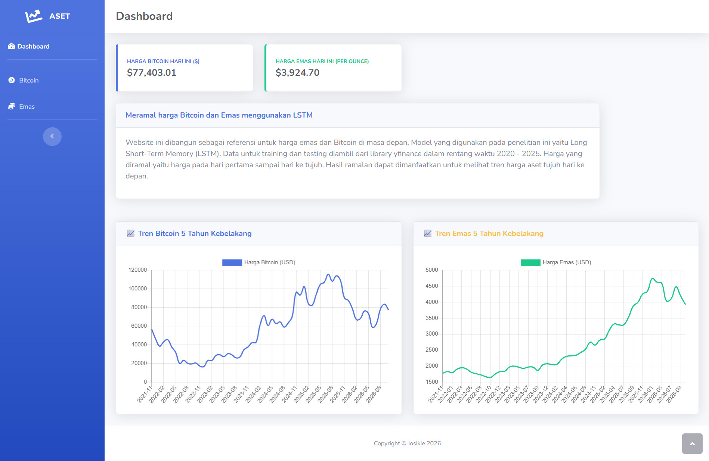
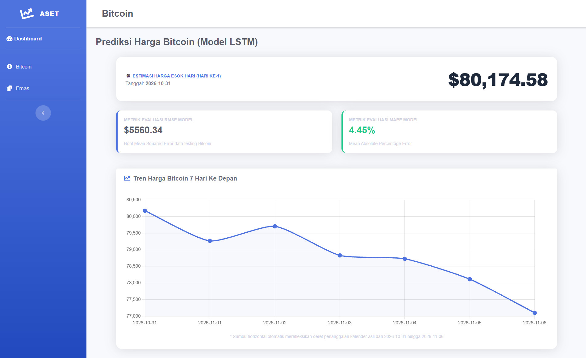
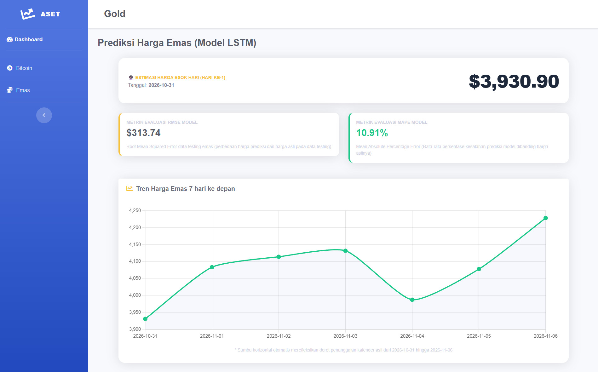
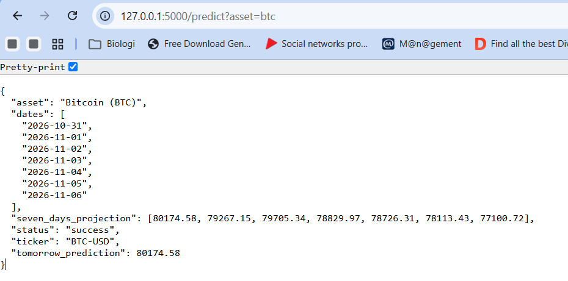
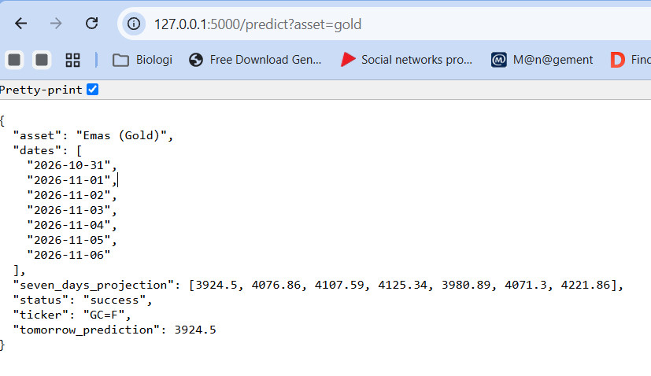

# Bitcoin and Gold Price Forecasting System
An AI-powered Web Application & API that help users gain insights about Bitcoin and Gold trends in the future, making it easier for users to evaluate risks before investing.

*🎓 Developed as an Undergraduate Bachelor's Thesis Project.*

**Core Features:**
1) Models: Built a custom LSTM (Long Short-Term Memory) deep learning model trained on historical market data from yfinance.
2) Backend & API: Developed a RESTful API to return predictions and historical data for both assets.
3) Frontend: Created an user-friendly and interactive web interface to show visualization and predictions.

## Website and RESTful API Demo
### Website ###
**Dashboard** 

Bitcoin

Gold

### RESTful API ###
Bitcoin

Gold

## How to run
1) Create a virtual environment: `python -m virtualenv env`
2) Run the project within the virtual environment: `source env/Scripts/activate`
3) Install the libraries from the requirements file: `pip install -r requirements.txt`
4) Run this Flask project: `python app.py`

## Endpoints
### Forecasting & Predictions
* **`GET /predict`**
  * **Query Parameter:** `asset=[bitcoin|gold]`
  * **Description:** Retrieves price predictions generated by the custom LSTM model.

### Historical & Real-Time Data
* **`GET /five_years_data`**
  * **Description:** Retrieves historical 5-year market data for Bitcoin and Gold.
* **`GET /btc_today`**
  * **Description:** Retrieves today's live price for Bitcoin.
* **`GET /gold_today`**
  * **Description:** Retrieves today's live price for Gold.

### Visualisation
* **`GET /`**
  * **Description:** Shows dashboard.
* **`GET /bitcoin`**
  * **Description:** Shows visualisation for Bitoin predictions.
* **`GET /gold`**
  * **Description:** Shows visualisation for Gold predictions.

## NOTES
1) The data used to train the model spans only 5 years, from 2020 to 2025. 
2) Technical variabel only (Closed price, volume).
3) Need better 